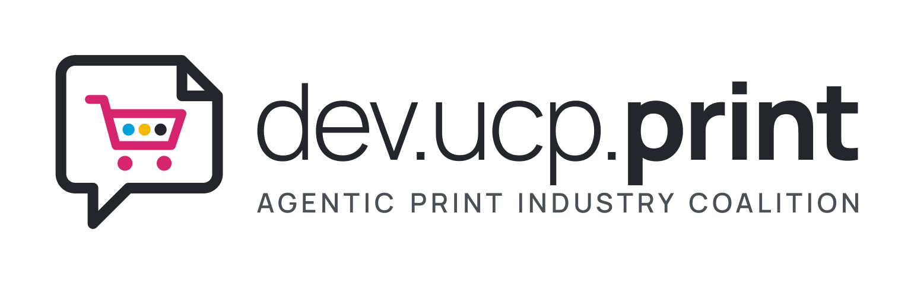

dev.ucp.print is an international initiative developing specifications to support print procurement through the [Universal Commerce Protocol (UCP)](https://ucp.dev), enabling AI agents to discover, configure, and purchase print products.

The initiative brings together [Initiative Online Print](https://www.initiative-online-print.de), [bvdm](https://www.bvdm-online.de), [Intergraf](https://www.intergraf.eu), [VIGC](https://www.vigc.be), [PRINTING United Alliance](https://www.printing.org), [CIP4](https://www.cip4.org), [Association for PRINT Technologies](https://printtechnologies.org), [dpsuisse](https://dpsuisse.ch), and the [Ghent Workgroup](https://gwg.org).

## Why print requires UCP extensions

The [Universal Commerce Protocol (UCP)](https://ucp.dev) provides an open framework for AI agents to discover and purchase products on behalf of users. However, print procurement introduces requirements that are not fully addressed by conventional e-commerce workflows.

Unlike products with predefined configurations and prices, print products are typically configured to order. Specifications such as dimensions, materials, color, quantity, and finishing determine what can be produced and at what price. Print production also requires additional workflows for submitting files, validating print readiness, and approving proofs before production.

Supporting these requirements within UCP calls for print-specific specifications that enable AI agents to understand a print provider's production capabilities, configure valid products, obtain accurate pricing, and manage print-specific order requirements.

## Two Specifications, One Goal

The initiative has established two teams working in parallel to develop complementary specifications for agentic print procurement: **Product Description** and **Checkout**.

### Team 1: Product Description

The Product Description team is developing a standardized approach for describing print products and their available configurations, enabling AI agents to discover and understand what print providers can produce.

The specification will build on existing industry standards, including [XJDF 2.2](https://www.cip4.org/print-automation/specifications), the CIP4 job data exchange format, and the [Periodic Table of Print & Graphic Elements (PTPGE)](https://ptpge.org), an open specification for describing and identifying print products.

While the product description specification may operate independently of the UCP Print Vertical, it will provide a common foundation for making print products discoverable and configurable by AI agents without requiring individual print providers to develop their own product terminology.

This work is being coordinated by the Product ID subcommittee of the [Ghent Workgroup](https://gwg.org), in collaboration with CIP4 and other industry participants.

### Team 2: Checkout

The Checkout team is developing print-specific extensions to the [Universal Commerce Protocol (UCP)](https://ucp.dev/latest/specification/overview/) to support the requirements of print procurement.

The approach builds on existing UCP capabilities for payment, delivery, discounts, and order status while addressing four additional requirements:

- **Print file submission:** Uploading files required for production.
- **Preflight and approval:** Supporting file validation, proofing, and print approval as distinct workflow steps.
- **Production terms:** Communicating print-specific production conditions, such as quantity tolerances.
- **Price confirmation:** Confirming the final price for the selected product configuration.

For integration with production workflows, the initiative recommends using the CIP4 Exchange Job Definition Format (XJDF).

## Project Status

The UCP Print Vertical is currently under development. The initiative is working toward initial specifications and a pilot implementation in the first quarter of 2027.

The specifications and technical approaches described here are subject to change as development and implementation testing progress.

## Contributing

Development of the UCP Print Vertical is coordinated through the participating industry organizations listed above.

Individuals and organizations interested in contributing to the initiative are encouraged to contact one of the participating organizations to learn more about opportunities for involvement.

As development progresses, this GitHub organization will serve as a resource for technical specifications, documentation, and related project materials.